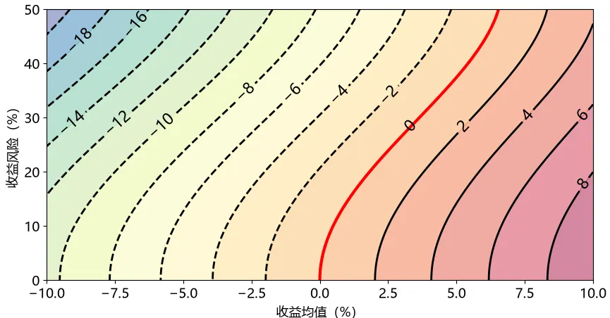

# 连续复合收益

在证券市场中——尤其对于长期投资的人而言——收益是一个复利，即不断相乘的关系。现在假设某只证券单交易日的收益率是 $ R $ ，这是一个随机变量。记第$ n $个交易日的收益率是 $ R_n $ ，它是一个与 $ R $ 的系综一致的随机过程，收益的复利关系首先意味着



**命题1（基本不等式）**：如果持有一张证券 $N$ 个交易日，平均的日收益率 $R_\mathrm{Daily} $ 是
$$
1 + R_\mathrm{Daily} = \left[\prod_{n=1}^N \left( 1 + R_n\right)\right]^{1/N} \leq 1 + \frac{1}{N}\sum_{n=1}^N R_n
$$


这个不等关系是几何平均不大于算术平均。上面的连乘可以用对数函数表达为求和，即令 $r_n = \ln(1+R_n) $ ，并将上式写为
$$
1 + R_\mathrm{Daily} = \exp\left[\frac{1}{N}\sum_{n=1}^N \ln\left( 1 + R_n\right)\right] = \exp\left(\frac{1}{N}\sum_{n=1}^N r_n\right)
$$
$ r_n $ 也被称作**对数收益率**。当长期持有时 $ N\rightarrow\infty $，如果求和收敛，按照大数定律，一般来讲它应当就是随机变量 $ r = \ln(1+R) $ 的期望 $ \mu'$ ，这个值也被称为**连续复合收益**，也即



**命题2（连续复合收益）**：对于长期持有的证券，平均收益率 $ R_\mathrm{Daily} $ 将是
$$
R_\mathrm{Daily} = e^{ \mu'} - 1 \quad,\quad  \mu' = \mathrm{E}[\ln(1+R)]
$$
这表明要靠长期持有证券获利，需要满足 $  \mu'=\mathrm{E}[\ln(1+R)]>0 $ 



如果回到命题1，并对不等号两侧取对数和极限的话，假设大数定律收敛，得到的是



**命题3（琴生不等式）**：收益率满足
$$
\mathrm{E}[\ln(1+R)] \leq \ln[1+\mathrm{E}(R)]
$$
因而 $ \mathrm{E}(R)>0 $ 并不能保证长期获利，因为它只保证了不等号右侧的部分大于零



将对数函数进行 Taylor 展开，得到
$$
 \mu' = \mathrm{E}\left[ \sum_{k=1}^\infty \frac{(-1)^{k-1}}{k}r^k\right] =  \mathrm{E}(R) - \frac{\mathrm{E}(R^2)}{2} + \frac{\mathrm{E}(R^3)}{3} - \frac{\mathrm{E}(R^4)}{4} + \cdots
$$

这里保留到 $R$ 的四阶矩——即保留期望、方差、偏度、峰度这四个统计量——上式成为
$$
\mu' = \mu_R - \frac{\sigma_R^2}{2} + \frac{\kappa_{3,R}}{3}\sigma^3_R - \frac{\kappa_{4,R}}{4}\sigma^4_R
$$
这里假定简单收益率的期望 $\mu_R$ 和方差 $\sigma^2_R$ 拥有相同的量级，这也比较符合一般的情况；并且保留 $\mu_R,\ \sigma^2$ 都到一阶，特别地，对于含 $k$ 阶矩的部分，允许保留到 $\kappa_{k,R} \sigma^k_R$ 

连续复合收益率的等高线图（采用了正态分布和四阶近似），只有落在红线右侧才能获得长期盈利

考虑到一般单日的 $ \mu_R $ 不太会超过10%，$ \sigma_R $ 一般也很难接近或超过 30%，所以除非偏度和峰度有明显的贡献，否则可以只保留期望和方差项。事实上，在有效市场和时间足够连续化的假设下，由于更高阶矩成为了 $\mathrm{d}t$ 的高阶小量，因而只保留期望和方差项是极限情况下的精确解



**命题4**：连续复合收益与简单收益率的期望和方差之间近似有 $\mu' \approx \mu_R - \sigma_R^2/2$ 



# 收益率的非遍历性

## 简单收益率的期望

另一方面，也可以在已知对数收益率相关统计量的情况下，求一段时间内的简单收益率，特别地一般就取年化值。当统计的天数够多时，命题2表明当 $N \rightarrow \infty$ 时，$R_\mathrm{Daily} \rightarrow e^{\mu'} - 1$ ，从而年化收益率是
$$
R'_\mathrm{Annual} = \lim_{N \rightarrow \infty}(1 + R_\mathrm{Daily})^{N_\mathrm{A}} - 1 = e^{\mu'N_\mathrm{A}} - 1
$$
 这里 $N_\mathrm{A}$ 是一年中的交易日数量，它一般约等于 252

然而，一般来说金融机构和各类软件披露出的年化收益率是这样计算的：
$$
1+R_\mathrm{Annual} = e^v \quad,\quad v = \sum_{n=1}^{N_\mathrm{A}} r_n \sim N\left(\mu'N_\mathrm{A}, \sigma^2N_\mathrm{A}\right)
$$
这里 $\mu'$ 仍然是对数收益率分布的期望，$\sigma$ 是对数收益率分布的标准差，正态分布是中心极限定理的结果。来求简单收益率 $R_\mathrm{Annual}$ 的期望
$$
\mathrm{E}(R_\mathrm{Annual}) = \mathrm{E}(e^v) - 1 = \frac{1}{\sqrt{2\pi N_\mathrm{A}}\sigma}\int_{-\infty}^{+\infty} e^v \exp\left[-\frac{(v-\mu'N_\mathrm{A})^2}{2\sigma^2N_\mathrm{A}}\right] \mathrm{d}v - 1
$$
指数上的部分是一个二次式，可以化为完全平方带上一个常数的形式，即

$$
v - \frac{(v-\mu'N_\mathrm{A})^2}{2\sigma^2N_\mathrm{A}} = -\frac{1}{2\sigma^2N_\mathrm{A}}\left[ v - \left(\mu'N_\mathrm{A}+\sigma^2N_\mathrm{A}\right) \right]^2 + \left(\mu'N_\mathrm{A} + \frac{\sigma^2}{2}N_\mathrm{A} \right)
$$
代入积分就有

$$
\mathrm{E}(R_\mathrm{Annual}) = e^{\mu'N_\mathrm{A} + \sigma^2N_\mathrm{A}/2} \int_{-\infty}^{+\infty} \frac{1}{\sqrt{2\pi N_\mathrm{A}}\sigma}\exp\left[-\frac{(v-\mu'N_\mathrm{A}-\sigma^2N_\mathrm{A})^2}{2\sigma^2N_\mathrm{A}}\right] \mathrm{d}v - 1 = e^{\mu'N_\mathrm{A} + \sigma^2N_\mathrm{A}/2} - 1
$$

然后就会发现 $ R'_\mathrm{Annual}<\mathrm{E}(R_\mathrm{Annual}) $ ；这是因为连乘不是线性操作，因此先乘后求期望和先求期望后乘的意义不同，具体来说

- $R'_\mathrm{Annual}$ 的计算过程是先估计出单日收益率的均值，然后再在时间轴上连乘积累收益；直观来说，先得出市场每天平均增长多少，然后让一个特定的投资者按照这个方式去累积收益
- $\mathrm{E}(R_\mathrm{Annual})$ 的计算过程是先在时间轴上“纵向地”连乘积累增益，然后再在周期末对整个系综“横向地”求一次均值；直观来说，先让市场上所有人都投资一年，一年后再将所有人的收益情况都算进来做个平均

由于复利的问题，在累积收益的过程中富者愈富、贫者愈贫。因此第二个结果会显著好于第一个结果（而第一个过程中，所有人都是以一个相同的定值累积收益的）。换句话说，**按照简单收益率考虑，所有投资者收益率的中位数是在平均数之下的**。实际上不止投资，工资报酬的分布也遵循同样的规律

___

如果随机过程是遍历的——即随着时间的演化，收益率取到某个值的概率和在收益率在系综中分布的概率是相同的。但现在却不然，就说明**证券市场的简单收益率不是一个遍历过程** 

所以如果要对同一只证券的收益情况跨时间纵向统计，往往用对数收益率，简单收益率会高估收益。不过简单收益率也有发挥作用的场合，就是在同一时间截面上，资产组合的简单收益率恰好是各资产按照市值加权的收益率，即
$$
R(\Delta t) = \frac{\sum_{k=1}^K [P_k(t+\Delta t) - P_k(t)]}{\sum_{k=1}^K P_k(t)} = \frac{\sum_{k=1}^K R_k(\Delta t)P_k(t)}{\sum_{k=1}^K P_k(t)} = \sum_{k=1}^K x_k R_k(\Delta t) \quad,\quad x_k = \frac{P_k(t)}{\sum_{k=1}^K P_k(t)}
$$

___

## 简单收益率的方差

同样在 $N \approx 252$ 的情况下，简单收益率的方差将是
$$
\mathrm{Var}(R_\mathrm{Annual}) = \mathrm{E}\left[\left( R_\mathrm{Annual}-\mathrm{E}(R_\mathrm{Annual}) \right)^2 \right] = \mathrm{E}\left[\left( e^v-\mathrm{E}(e^v) \right)^2 \right] = \mathrm{E}(e^{2v}) - e^{2(\mu'N_\mathrm{A} + \sigma^2N_\mathrm{A}/2)}
$$
对于 $\mathrm{E}(e^{2v})$ ，计算方法和期望时一样，与正态分布的概率密度函数结合后可以化为一个二次式，结果是
$$
\mathrm{E}(e^{2v}) = e^{2(\mu'N_\mathrm{A} + \sigma^2N_\mathrm{A})} \int_{-\infty}^{+\infty} \frac{1}{\sqrt{2\pi N_\mathrm{A}}\sigma}\exp\left[-\frac{(v-\mu'N_\mathrm{A}-2\sigma^2N_\mathrm{A})^2}{2\sigma^2N_\mathrm{A}}\right] \mathrm{d}v = e^{2(\mu'N_\mathrm{A} + \sigma^2N_\mathrm{A})}
$$
所以方差是
$$
\mathrm{Var}(R_\mathrm{Annual}) = e^{\mu' N_\mathrm{A} + \sigma^2 N_\mathrm{A}} \left( e^{\sigma^2N_\mathrm{A}} - 1 \right)
$$
