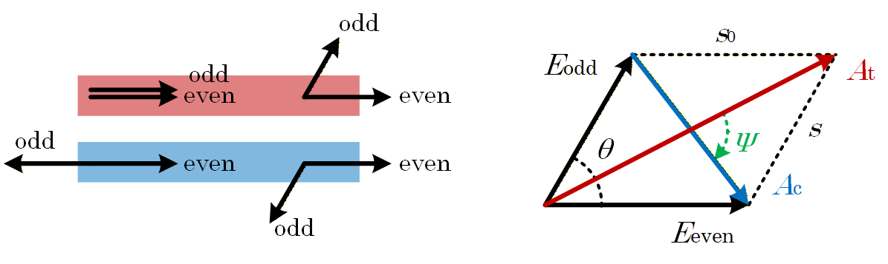
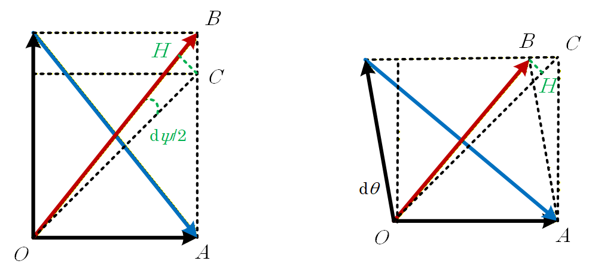

# 相矢图

分析 2x2 定向耦合器的一个简单的方法是用所谓的正交模式法，见 R. Youngquist, L. Stokes, and H. Shaw, IEEE J. Quantum Electron., Vol. 19, pp. 1888(1983). 

这种方法认为耦合器中存在两个模式（准确说是两类），一个是关于两个波导对称的（Even），另一个是关于两个波导反对称的（Odd）。这两个模式的相位差会随空间变化，通过控制耦合区长度来控制这个相位差即可控制耦合的分光比

现在固定对称模式的相位不动，让反对称模式的相位旋转，即可绘制出所谓的相矢图，如下所示。传输电场（输入光所在波导的输出电场，用下标 $\mathrm{t}$ 表示）是对称模式与反对称模式相加，耦合电场（用下标 $\mathrm{c}$ 表示）是对称模式减去反对称模式

在理想情况下，两个模式之间没有差分损耗，那么不管是加还是减，两个模式的相矢总是张成菱形，而输出的总电场分别是菱形的两条对角线。由于菱形的性质，这两个输出电场之间总是存在着90°的相位差

将对称模式记为 $E_{\mathrm{even}} = s_0$ ，非对称模式记为 $E_{\mathrm{odd}} = s e^{j\theta}$ ，那么两个输出总电场分别是
$$
A_\mathrm{t} = s_0 + se^{j\theta} \quad,\quad A_\mathrm{c} = s_0 - se^{j\theta}
$$
从而两个输出光强分别是
$$
\begin{aligned}
& I_\mathrm{t} = (s_0 + s\cos\theta)^2 + s^2\sin\theta = s_0^2 + s^2 + 2s_0 s\cos\theta \\
& I_\mathrm{c} = (s_0 - s\cos\theta)^2 + s^2\sin\theta = s_0^2 + s^2 - 2s_0 s\cos\theta
\end{aligned}
$$
两个输出电场之间的夹角 $\psi$ 可以由下式计算出
$$
\psi = \angle\left( \frac{A_\mathrm{c}}{A_\mathrm{t}} \right) \quad,\quad \frac{A_\mathrm{c}}{A_\mathrm{t}} = \frac{s_0^2 - s^2 - j2s_0s\sin\theta}{s_0^2 + s^2 + 2s_0 s\cos\theta}
$$
在没有差分损耗，即 $s=s_0$ 时，$A_\mathrm{c}/A_\mathrm{t}$显然是一个纯虚值，那么 $A_{\mathrm{c}}$ 和 $A_{\mathrm{t}}$ 之间自然始终是正交的

与此同时，在输入时显然 $\theta = 0$ ，且由于刚进入耦合器还没有损耗所以 $s=s_0$ ，因此输入光强 $I_0 = 4s_0^2$ 

# 非理想误差

## 分析法

通过设计波导长度可以控制 $\theta$ ，但由于两个模式间存在差分损耗，以及温度可能带来耦合区长度的微变

记微小的差分损耗（的相反数，因为损耗一定表现为负值）为 $\mathrm{d}s$ ，非理想的角度漂移为 $\mathrm{d}\theta$ ，那么
$$
\begin{aligned}
& \mathrm{d}A_\mathrm{t} = \frac{\partial A_\mathrm{t}}{\partial s} \mathrm{d}s + \frac{\partial A_\mathrm{t}}{\partial \theta} \mathrm{d}\theta = e^{j\theta} \mathrm{d}s + js e^{j\theta} \mathrm{d}\theta \\[12pt]
& \mathrm{d}A_\mathrm{c} = \frac{\partial A_\mathrm{c}}{\partial s} \mathrm{d}s + \frac{\partial A_\mathrm{c}}{\partial \theta} \mathrm{d}\theta = -e^{j\theta} \mathrm{d}s - js e^{j\theta} \mathrm{d}\theta
\end{aligned}
$$
而光强则是 $\mathrm{d}I_\mathrm{t} = \mathrm{d}(A_\mathrm{t}A_\mathrm{t}^\ast) = A_t \mathrm{d}A_\mathrm{t}^\ast + A_\mathrm{t}^\ast \mathrm{d}A_\mathrm{t}$ ，代入即得到
$$
\begin{aligned}
\mathrm{d}I_\mathrm{t} &= (s_0 + se^{j\theta})(e^{-j\theta} \mathrm{d}s - js e^{-j\theta} \mathrm{d}\theta) + (s_0 + se^{-j\theta})(e^{j\theta} \mathrm{d}s + js e^{j\theta} \mathrm{d}\theta) \\
&= 2(s + s_0\cos\theta)\mathrm{d}s -2s_0 s\sin\theta \mathrm{d}\theta
\end{aligned}
$$
同样的做法得到
$$
\begin{aligned}
\mathrm{d}I_\mathrm{c} &= (s_0 - se^{j\theta})(-e^{-j\theta} \mathrm{d}s + js e^{-j\theta} \mathrm{d}\theta) + (s_0 - se^{-j\theta})(-e^{j\theta} \mathrm{d}s - js e^{j\theta} \mathrm{d}\theta) \\
&= 2(s - s_0\cos\theta)\mathrm{d}s +2s_0 s\sin\theta \mathrm{d}\theta
\end{aligned}
$$

___

在光学测量中，只有光强是可测的，所以上面两式是否构成可解的方程组尤为重要。将上面两式写为
$$
\left[\begin{matrix} \mathrm{d}I_\mathrm{t} \\ \mathrm{d}I_\mathrm{c}\end{matrix}\right] = 
\left[\begin{matrix}  2(s+ s_0\cos\theta) & -2s_0 s\sin\theta \\  2(s - s_0\cos\theta) & 2s_0 s\sin\theta \end{matrix}\right]
\left[\begin{matrix} \mathrm{d}s \\ \mathrm{d}\theta \end{matrix}\right]
$$
这个矩阵的行列式是
$$
\det \left[\begin{matrix}  2(s+ s_0\cos\theta) & -2s_0 s\sin\theta \\  2(s - s_0\cos\theta) & 2s_0 s\sin\theta \end{matrix}\right] = 8s_0s^2\sin\theta
$$
这个行列式只有在 $s=0$ 或 $\theta = 0,\pi$ 的时候为零，在其它偏置点处都不为零。因此除了两种特殊情况之外，矩阵总是可逆的，因而方程组总有唯一解

单独考虑特殊情况，$s=0$ 意味着反对称模式完全消失，那么耦合器已经失去功能了，这一般不太可能发生；而 $\theta = 0$ 意味着只有传输光波输出，$\theta = \pi$ 则是只有耦合光波输出

___

另一方面，$\psi$ 的微分是
$$
\mathrm{d}\psi = \mathrm{d} \arctan\left( -\frac{2s_0 s \sin\theta}{s_0^2 - s^2} \right) = -\frac{(s_0^2 - s^2)\mathrm{d}(2s_0 s \sin\theta) - 2s_0 s \sin\theta \mathrm{d}(s_0^2 - s^2) }{(s_0^2 - s^2)^2 + 4s_0^2 s^2 \sin^2\theta}
$$
分子上的微分分别是 $\mathrm{d}(2s_0 s \sin\theta) = 2s_0\sin\theta \mathrm{d}s + 2s_0s\cos\theta\mathrm{d}\theta$ 和 $\mathrm{d}(s_0^2 - s^2) = -2s\mathrm{d}s$ ，代入得到
$$
\mathrm{d}\psi = -\frac{[2s_0(s_0^2 - s^2)\sin\theta + 4s_0 s^2 \sin\theta ]\mathrm{d}s + 2s_0s(s_0^2 - s^2)\cos\theta\mathrm{d}\theta }{(s_0^2 - s^2)^2 + 4s_0^2 s^2 \sin^2\theta}
$$
尤其值得考虑的是**均等分光**的情况，此时偏置点 $s = s_0, \theta = \pi/2$ ，那么
$$
\begin{aligned}
& \mathrm{d}A_\mathrm{t} = j \mathrm{d}s - s_0 \mathrm{d}\theta \\[12pt]
& \mathrm{d}A_\mathrm{c} = j \mathrm{d}s + s_0 \mathrm{d}\theta
\end{aligned}
$$
 由于电场强度难以测量，因此更有意义的是
$$
\begin{aligned}
& \mathrm{d}I_\mathrm{t} = 2s_0 \mathrm{d}s - 2s_0^2 \mathrm{d}\theta = \sqrt{I_0} \mathrm{d}s - \frac{I_0}{2} \mathrm{d}\theta \\[12pt]
& \mathrm{d}I_\mathrm{c} = 2s_0 \mathrm{d}s + 2s_0^2 \mathrm{d}\theta = \sqrt{I_0} \mathrm{d}s + \frac{I_0}{2} \mathrm{d}\theta
\end{aligned}
$$
方程组中矩阵的行列式显然是 $I_0\sqrt{I_0} \neq 0$ ，所以只要测量 $\mathrm{d}I_\mathrm{t}$ 和 $\mathrm{d}I_\mathrm{c}$ 即可得到差分损耗 $\mathrm{d}s$ 和角度漂移 $\mathrm{d}\theta$ ，进而也就可以得到 $\mathrm{d}\psi$ 
$$
\mathrm{d}\psi = -\frac{\mathrm{d}s}{s_0} = -\frac{2}{\sqrt{I_0}}\mathrm{d}s
$$

## 作图法（均等分光）

对于均等分光的特殊情况，几何作图法也是有效的做法，并将导出完全一致的结果

左图是存在差分损耗的情况，此时$\triangle BHC$ 是一个等腰直角三角形，$BC = \mathrm{d}s$ ，$CH = BC\sin(\pi/4)=BC/\sqrt{2}$ ，$BH = BC\cos(\pi/4)=BC/\sqrt{2}$ ；$\triangle OHC$ 则是一个顶角无限小的等腰三角形（我的一位老师习惯称它为“直角等腰三角形”，这是因为 $\angle HOC$ 无限小，导致 $\angle OCH, \angle CHO$ 都无限接近90° ）

$OC$ 是没有差分损耗时的 $A_\mathrm{t}$ 模长，$OB$ 则是引入差分损耗后的模长，它们的差是
$$
\mathrm{d}|A_\mathrm{t}| = OB - OC = OB-OH = BH = \frac{\mathrm{d}s}{\sqrt{2}}
$$
对于 $|A_{\mathrm{c}}|$ ，情况完全一致。偏置点满足 $|A_\mathrm{t}| = |A_\mathrm{c}| = OC = \sqrt{2}s_0$ ，所以
$$
\frac{\partial I_\mathrm{c}}{\partial s} = \frac{\partial I_\mathrm{t}}{\partial s} = \frac{2|A_\mathrm{t}|\mathrm{d}|A_\mathrm{t}|}{\mathrm{d}s} = 2s_0 = \sqrt{I_0}
$$
与此同时，$\angle HOC$ 显然是 $\mathrm{d}\psi/2$ ，所以
$$
\mathrm{d}\psi = -2\frac{CH}{OC} = -2\frac{\mathrm{d}s}{2s_0} = -\frac{\mathrm{d}s}{s_0} = -\frac{2}{\sqrt{I_0}}\mathrm{d}s
$$
右图则是存在角度漂移的情况，此时 $\triangle BHC$ 也是一个等腰直角三角形，$BC = s_0\mathrm{d}\theta$ ，$BH=CH=BC/\sqrt{2}$ ；$\triangle OHB$ 是一个顶角无限小的等腰三角形

$OC$ 是没有角度漂移时的 $A_\mathrm{t}$ 模长，$OB$ 则是引入角度漂移后的模长，它们的差是
$$
\mathrm{d}|A_\mathrm{t}| = OB - OC = OH-OC = -CH = -\frac{s_0\mathrm{d}\theta}{\sqrt{2}}
$$
对于 $|A_{\mathrm{c}}|$ ，情况则完全相反。不过偏置点仍然是 $|A_\mathrm{t}| = |A_\mathrm{c}| = OC = \sqrt{2}s_0$ ，所以
$$
\begin{aligned}
& \frac{\partial I_\mathrm{t}}{\partial \theta} = \frac{2|A_\mathrm{t}|\mathrm{d}|A_\mathrm{t}|}{\mathrm{d}\theta} = -2s_0^2 = -\frac{I_0}{2} \\[12pt]
& \frac{\partial I_\mathrm{c}}{\partial \theta} = \frac{2|A_\mathrm{c}|\mathrm{d}|A_\mathrm{c}|}{\mathrm{d}\theta} = 2s_0^2 = \frac{I_0}{2}
\end{aligned}
$$
菱形的对角线始终垂直，因此角度漂移带来的 $\mathrm{d}\psi = 0$ ，最终仍然得到
$$
\left[\begin{matrix} \mathrm{d}I_\mathrm{t} \\ \mathrm{d}I_\mathrm{c}\end{matrix}\right] = 
\left[\begin{matrix}  \sqrt{I_0} & -I_0/2 \\  \sqrt{I_0} & I_0/2 \end{matrix}\right]
\left[\begin{matrix} \mathrm{d}s \\ \mathrm{d}\theta \end{matrix}\right] \quad,\quad \mathrm{d}\psi = -\frac{2}{\sqrt{I_0}}\mathrm{d}s
$$
