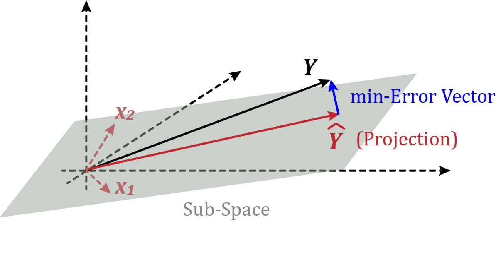
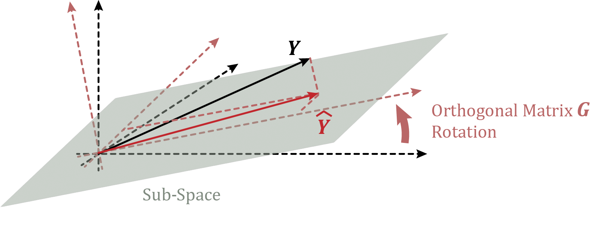

# 最小二乘回归

## 参数估计

假定随机变量 $y$ 可以由随机向量 $\boldsymbol{x}$ 各分量的线性组合来表示，即 $y = \boldsymbol{x}^T \boldsymbol{\beta}  + \alpha + u$ ，这里 $u$ 是一个代表线性关系无法解释的误差随机变量；那么对于测量得到的样本序列 $\{ \boldsymbol{x}_i \}$ 和 $\{y_i\}$ ，理论上应当满足
$$
\left[\begin{matrix} y_1 \\ \vdots \\ y_n \end{matrix}\right] = \left[\begin{matrix} \boldsymbol{x}_1^T & 1 \\ \vdots & \vdots \\ \boldsymbol{x}_n^T & 1 \end{matrix}\right] \left[\begin{matrix} \boldsymbol{\beta} \\ \alpha \end{matrix}\right] + \left[\begin{matrix} u_1 \\ \vdots \\ u_n \end{matrix}\right] \quad
$$
将其记为 $\boldsymbol{Y} = \boldsymbol{X}\boldsymbol{\theta} + \boldsymbol{U}$ ，从已知的样本序列来估计 $\boldsymbol{\beta}, \alpha$ 的问题被称为线性回归。特别地，如果满足以下条件：
1. **线性解释是充分的**：即 $u$ 与 $\boldsymbol{x}$ 之间已经没有相关性，且在已知 $\boldsymbol{X}$ 的情况下 $\boldsymbol{U}$ 是一个白噪声序列，即
   $$
   \mathrm{E}(u|\boldsymbol{x}) = 0 \quad,\quad \mathrm{Cov}[(\boldsymbol{U}, \boldsymbol{U})|\boldsymbol{X}] = \sigma^2\boldsymbol{I}
   $$

2. **线性解释变量的选择是必要的**：即对于 $\boldsymbol{X}$ 中任意一列，其无法被其它列线性表出

此时回归的解法被称为普通最小二乘（OLS），它的思路是找到**欧氏空间**中的正交投影

首先从上式可以看出：

- 实际的采样值 $\boldsymbol{Y}$ 构成一个 $n$ 维向量
- 采样值 $\boldsymbol{X}$ 则构成一个 $n$ 行的矩阵，每一列就是一个 $n$ 维向量；这个向量组将张成 $n$ 维空间中的一个子空间，维数为 $\mathrm{dim}(\boldsymbol{x})+1$ 

向量组的一个线性组合同样位于这个子空间内，距离实际的采样值 $\boldsymbol{Y}$ 最近的那个线性组合就被称为是 OLS 的预测值 $\hat{\boldsymbol{Y}}$ ，将线性组合系数记为 $\hat{\theta}$ ，也就是说 $\hat{\boldsymbol{Y}} = \boldsymbol{X}\hat{\boldsymbol{\theta}}$ ；测量得到的值和回归模型预测值之间的误差用欧氏距离来度量，也就是
$$
E^2 = \left| \boldsymbol{Y} - \hat{\boldsymbol{Y}} \right|^2 = \left( \boldsymbol{Y} - \hat{\boldsymbol{Y}} \right)^T \left( \boldsymbol{Y} - \hat{\boldsymbol{Y}} \right) = \left( \boldsymbol{Y} - \boldsymbol{X}\hat{\boldsymbol{\theta}}\right)^T \left( \boldsymbol{Y} - \boldsymbol{X}\hat{\boldsymbol{\theta}} \right)
$$
它是关于估计值 $\hat{\boldsymbol{\theta}}$ 的二次函数，因而应当只有一个极值点。且由于其作为欧氏距离的意义，一定是一个极小值点。极值条件由梯度为零给出，即
$$
\frac{\partial E^2}{\partial \hat{\boldsymbol{\theta}}} = 2\boldsymbol{X}^T\left( \boldsymbol{X}\hat{\boldsymbol{\theta}} - \boldsymbol{Y} \right) = 0
$$

直接得到 OLS 的估计结果 $\hat{\boldsymbol{\theta}} = (\boldsymbol{X}^T\boldsymbol{X})^{-1} (\boldsymbol{X}^T\boldsymbol{Y})$ 

## 估计的无偏性

将 $\hat{\boldsymbol{\theta}}$ 表达式中的 $\boldsymbol{Y}$ 写为 $\boldsymbol{X}\boldsymbol{\theta} + \boldsymbol{U}$ ，那么就得到
$$
\hat{\boldsymbol{\theta}} = (\boldsymbol{X}^T\boldsymbol{X})^{-1} [(\boldsymbol{X}^T\boldsymbol{X})\boldsymbol{\theta} + \boldsymbol{X}^T\boldsymbol{U}] = \boldsymbol{\theta} + (\boldsymbol{X}^T\boldsymbol{X})^{-1}\boldsymbol{X}^T\boldsymbol{U}
$$
矩阵 $\boldsymbol{X}$ 是已经通过测量得知的，所以对上式求条件期望
$$
\mathrm{E}(\hat{\boldsymbol{\theta}}|\boldsymbol{X}) = \boldsymbol{\theta} + (\boldsymbol{X}^T\boldsymbol{X})^{-1}\boldsymbol{X}^T\mathrm{E}(\boldsymbol{U}|\boldsymbol{X})
$$
由于前面假定已知 $\boldsymbol{X}$ 的情况下 $\boldsymbol{U}$ 是一个白噪声序列，所以 $\mathrm{E}(\boldsymbol{U}|\boldsymbol{X}) = 0$ ，这就给出了 $\mathrm{E}(\hat{\boldsymbol{\theta}}|\boldsymbol{X}) = \boldsymbol{\theta}$ 

然后应用
$$
\mathrm{E}(\hat{\boldsymbol{\theta}}) = \int \hat{\boldsymbol{\theta}} \cdot p(\hat{\boldsymbol{\theta}}, \boldsymbol{x}_1, \cdots, \boldsymbol{x}_n) \mathrm{d}\hat{\boldsymbol{\theta}}\mathrm{d}\boldsymbol{x}_1\cdots\mathrm{d}\boldsymbol{x}_n = \int  \left[ \int \hat{\boldsymbol{\theta}} \frac{p(\hat{\boldsymbol{\theta}}, \boldsymbol{x}_1, \cdots, \boldsymbol{x}_n)}{p_x(\boldsymbol{x}_1, \cdots, \boldsymbol{x}_n)} \mathrm{d}\hat{\boldsymbol{\theta}} \right]  p_x(\boldsymbol{x}_1, \cdots, \boldsymbol{x}_n)\mathrm{d}\boldsymbol{x}_1\cdots\mathrm{d}\boldsymbol{x}_n
$$

这里 $p_x = \int_{-\infty}^{+\infty} p \mathrm{d}\hat{\boldsymbol{\theta}}$ 是序列 $\{ \boldsymbol{x}_i \}$ 的联合边际概率；事实上上式就是
$$
\mathrm{E}(\hat{\boldsymbol{\theta}}) = \mathrm{E}_x[ \mathrm{E}(\hat{\boldsymbol{\theta}}|\boldsymbol{X}) ] = \mathrm{E}_x( \boldsymbol{\theta} ) = \boldsymbol{\theta}
$$
所以就有了



**普通最小二乘估计的无偏性**：如果用随机变量 $\boldsymbol{x}$ 对随机变量 $y$  进行线性解释的关系式为 $y = \boldsymbol{\beta}^T \boldsymbol{x} + \alpha + u$ ，且在已知 $\boldsymbol{x_i}$ 的情况下 $\{ u_i \}$ 是白噪声序列，那么用普通最小二乘估计出的参数 $\hat{\boldsymbol{\beta}}, \hat{\alpha}$ 都是无偏的，即 $\mathrm{E}(\hat{\boldsymbol{\beta}}) = \boldsymbol{\beta}$ ；$\mathrm{E}(\hat{\alpha}) = \alpha$ 



## 估计的相合性

将 $\hat{\boldsymbol{\theta}}$ 写为 $\hat{\boldsymbol{\theta}} - \boldsymbol{\theta} = (\boldsymbol{X}^T\boldsymbol{X})^{-1}\boldsymbol{X}^T\boldsymbol{U}$ ，不妨展开写为
$$
\hat{\boldsymbol{\theta}} - \boldsymbol{\theta} = \left[\begin{matrix} \sum_{i=1}^n x_{1i}^2/n & \cdots & \sum_{i=1}^n x_{1i}/n \\ \vdots & \ddots & \vdots \\ \sum_{i=1}^n x_{1i}/n & \cdots & 1 \end{matrix}\right]^{-1} \left[\begin{matrix} \sum_{i=1}^n u_ix_{1i}/n \\ \vdots \\ \sum_{i=1}^n u_i/n \end{matrix}\right]
$$
按照 Khinchin 大数定律，只要对应的期望存在，那么当 $n \rightarrow \infty$ 时，上式依概率收敛到
$$
\hat{\boldsymbol{\theta}} - \boldsymbol{\theta} \overset{\mathrm{p}}{\longrightarrow} \left[\begin{matrix} \mathrm{Cov}(\boldsymbol{x}, \boldsymbol{x}) & \mathrm{E}(\boldsymbol{x}) \\ \mathrm{E}(\boldsymbol{x}^T) & 1 \end{matrix}\right]^{-1} \left[\begin{matrix} \mathrm{Cov}(u, \boldsymbol{x}) \\ \mathrm{E}(u) \end{matrix}\right]
$$
线性解释的充分假设已经表明 $u$ 与 $\boldsymbol{x}$ 之间没有相关性，即 $\mathrm{Cov}(u, \boldsymbol{x}) = 0$ ，且白噪声假设表明 $\mathrm{E}(u|\boldsymbol{x})=0$ ，所以
$$
\mathrm{E}(u) = \mathrm{E}_x[ \mathrm{E}(u|\boldsymbol{x}) ] = 0
$$
这就给出

 

**普通最小二乘估计的无偏性**：如果用随机变量 $\boldsymbol{x}$ 对随机变量 $y$  进行线性解释的关系式为 $y = \boldsymbol{\beta}^T \boldsymbol{x} + \alpha + u$ ，且 $\mathrm{E}(u|\boldsymbol{x}) = 0$ ，$\mathrm{Cov}(u, \boldsymbol{x}) = 0$ ，那么用普通最小二乘估计出的参数 $\hat{\boldsymbol{\beta}}, \hat{\alpha}$ 都是相合的，即 $\hat{\boldsymbol{\beta}} - \boldsymbol{\beta} \overset{\mathrm{p}}{\longrightarrow} 0$ ；$\hat{\alpha} - \alpha \overset{\mathrm{p}}{\longrightarrow} 0$ 



# 假设检验

## 残差的分布

利用 $\hat{\boldsymbol{Y}} = \boldsymbol{X}\hat{\boldsymbol{\theta}}$ 以及 OLS 给出的 $\hat{\boldsymbol{\theta}} = (\boldsymbol{X}^T\boldsymbol{X})^{-1} (\boldsymbol{X}^T\boldsymbol{Y})$ ，将有
$$
\hat{\boldsymbol{Y}} = \boldsymbol{P}\boldsymbol{Y} \quad,\quad \boldsymbol{P} = \boldsymbol{X} (\boldsymbol{X}^T\boldsymbol{X})^{-1} \boldsymbol{X}^T
$$
这里 $\boldsymbol{P}$ 是投影算子，不论直观想象，还是代入计算都可以得到 $\boldsymbol{P}^2 = \boldsymbol{P}$ ；但并不能通过在等式两侧同时乘上 $\boldsymbol{P}^{-1}$ 得到 $\boldsymbol{P} = \boldsymbol{I}$ ，这是因为除非子空间正是全空间，否则 $\boldsymbol{P}$ 不是满秩的，因而不是可逆的。它的秩等于子空间的维数，即 $\mathrm{rank}(\boldsymbol{P}) = \mathrm{dim}(\boldsymbol{x})+1 = \mathrm{dim}(\boldsymbol{\theta})$ 

可以通过一个正交矩阵 $\boldsymbol{G}$ 对 $\boldsymbol{P}$ 完成对角化。正交矩阵是特殊的满秩投影矩阵，它的所有列构成一组**完备的正交归一化基**，因而几何意义是将向量投影到这组正交基上。也就是说 $\boldsymbol{Y} = \boldsymbol{G}\boldsymbol{G}^T\boldsymbol{Y}$ ，这里 $\boldsymbol{G}^T\boldsymbol{Y}$ 是获取 $\boldsymbol{Y}$ 在正交基系上的坐标，而再乘上一个 $\boldsymbol{G}$ 就是按照坐标对基进行线性组合。总之这给出 $\boldsymbol{G}\boldsymbol{G}^T = \boldsymbol{I}$ 

通过选取合适的完备正交基系，使得基系中的前 $\mathrm{rank}(\boldsymbol{P})$ 个基向量都位于 $\boldsymbol{P}$ 对应的子空间内。那么在这组基系下，$\hat{\boldsymbol{Y}}$ 的前 $\mathrm{rank}(\boldsymbol{P})$ 个坐标应该和 $\boldsymbol{Y}$ 的坐标相同，而后 $n-\mathrm{rank}(\boldsymbol{P})$ 个坐标则是零，这也就是说
$$
\boldsymbol{G}^T\hat{\boldsymbol{Y}} = \left[\begin{matrix} \boldsymbol{I}_{\mathrm{rank}(\boldsymbol{P})} & 0 \\ 0 & 0 \end{matrix}\right]\boldsymbol{G}^T\boldsymbol{Y} \quad\Rightarrow\quad \boldsymbol{P} = \boldsymbol{G}\left[\begin{matrix} \boldsymbol{I}_{\mathrm{rank}(\boldsymbol{P})} & 0 \\ 0 & 0 \end{matrix}\right]\boldsymbol{G}^T
$$

这里利用了 $\boldsymbol{G}\boldsymbol{G}^T = \boldsymbol{I}$ ；至于 $\boldsymbol{X}$ ，由于其各列正是子空间内的向量，因此获取坐标的结果 $\boldsymbol{G}^T\boldsymbol{X}$ 只有前 $\mathrm{rank}(\boldsymbol{P})$ 行是非零的，而后 $n-\mathrm{rank}(\boldsymbol{P})$ 行都是零

在这种情况下来看残差， 它可以重新写为
$$
E^2 = \left( \boldsymbol{Y} - \hat{\boldsymbol{Y}} \right)^T \left( \boldsymbol{Y} - \hat{\boldsymbol{Y}} \right) = \left( \boldsymbol{Y}^T\boldsymbol{G} - \hat{\boldsymbol{Y}}^T\boldsymbol{G} \right) \left( \boldsymbol{G}^T\boldsymbol{Y} - \boldsymbol{G}^T\hat{\boldsymbol{Y}} \right) = \boldsymbol{Y}^T\boldsymbol{G} \left[\begin{matrix} 0 & 0 \\ 0 & \boldsymbol{I}_{n-\mathrm{rank}(\boldsymbol{P})} \end{matrix}\right] \boldsymbol{G}^T\boldsymbol{Y}
$$
代入 $\boldsymbol{Y} = \boldsymbol{X}\boldsymbol{\theta} + \boldsymbol{U}$ ，由于 $\boldsymbol{G}^T\boldsymbol{X}$ 只有前 $\mathrm{rank}(\boldsymbol{P})$ 行非零的特性，它将不对上式构成贡献，所以最后得到一个二次型
$$
E^2 = \boldsymbol{U}^T\boldsymbol{G} \left[\begin{matrix} 0 & 0 \\ 0 & \boldsymbol{I}_{n-\mathrm{rank}(\boldsymbol{P})} \end{matrix}\right] \boldsymbol{G}^T\boldsymbol{U} = \sum_{i=\mathrm{rank}(\boldsymbol{P})+1}^n W_i^2
$$
这里向量 $\boldsymbol{W}=\boldsymbol{G}^T\boldsymbol{U}$ 

特别地，在已知 $\boldsymbol{X}$ 的情况下，如果还假设 $\boldsymbol{U}$ 是一个 Gauss 白噪声，也就是说 $\boldsymbol{U}|\boldsymbol{X} \sim N(0, \sigma^2\boldsymbol{I})$ ，那么按照多元正态变量的性质，$\boldsymbol{W}|\boldsymbol{X}$ 也服从正态分布，它的期望自然也是零，协方差矩阵则是
$$
\mathrm{Cov}[(\boldsymbol{W}, \boldsymbol{W})|\boldsymbol{X}] = \mathrm{E}\left( \boldsymbol{W}\boldsymbol{W}^T \right) = \boldsymbol{G}^T \mathrm{E}\left( \boldsymbol{U}\boldsymbol{U}^T \right) \boldsymbol{G} = \sigma^2 \boldsymbol{G}^T \boldsymbol{G} = \sigma^2\boldsymbol{I}
$$
也就是说仍然有 $\boldsymbol{W}|\boldsymbol{X} \sim N(0, \sigma^2\boldsymbol{I})$ ，那么 $E^2$ 就是 $n-\mathrm{rank}(\boldsymbol{P})$ 个独立的正态变量平方相加，因而按照 $\chi^2$ 分布的定义就有



**正态假设下的残差分布**：假设 OLS 的线性关系 $\boldsymbol{Y} = \boldsymbol{X}\boldsymbol{\theta} + \boldsymbol{U}$ 中有 $\boldsymbol{U}|\boldsymbol{X} \sim N(0, \sigma^2\boldsymbol{I})$ ，那么残差 $E^2/\sigma^2=|\boldsymbol{Y} - \hat{\boldsymbol{Y}}|^2/\sigma^2$ 服从 $\chi^2(n-\mathrm{dim}(\boldsymbol{\theta}))$ 分布



## 对单个线性关系的检验

在正态假设下，当 $\boldsymbol{X}$ 已知时 $\hat{\boldsymbol{\theta}} - \boldsymbol{\theta} = (\boldsymbol{X}^T\boldsymbol{X})^{-1}\boldsymbol{X}^T\boldsymbol{U}$ ，它也服从零期望的正态分布，按照和上面完全相同的推导过程得到
$$
\mathrm{Cov}[(\boldsymbol{\theta}, \boldsymbol{\theta})|\boldsymbol{X}] = (\boldsymbol{X}^T\boldsymbol{X})^{-1}\boldsymbol{X}^T\mathrm{Cov}(\boldsymbol{U}, \boldsymbol{U})\boldsymbol{X}[(\boldsymbol{X}^T\boldsymbol{X})^{-1}]^T = \sigma^2 (\boldsymbol{X}^T\boldsymbol{X})^{-1}(\boldsymbol{X}^T\boldsymbol{X})(\boldsymbol{X}^T\boldsymbol{X})^{-1} = (\boldsymbol{X}^T\boldsymbol{X})^{-1}
$$
第二个等号利用了对称矩阵的逆矩阵仍然是对称的，因此可以得到 $\hat{\boldsymbol{\theta}}|\boldsymbol{X} \sim N\left(\boldsymbol{\theta}, \sigma^2(\boldsymbol{X}^T\boldsymbol{X})^{-1} \right)$ ；另外上面的表达式可以重新写为 $\hat{\boldsymbol{\theta}} - \boldsymbol{\theta} = (\boldsymbol{X}^T\boldsymbol{X})^{-1}\boldsymbol{X}^T\boldsymbol{G}\boldsymbol{W}$ ，并计算
$$
\begin{aligned}
\mathrm{Cov}[(\hat{\boldsymbol{\theta}}, E^2)|\boldsymbol{X}] &= \mathrm{E}\left[ (E^2 - \mathrm{E}(E^2))(\hat{\boldsymbol{\theta}} - \boldsymbol{\theta}) | \boldsymbol{X}\right] \\[12pt]
&= (\boldsymbol{X}^T\boldsymbol{X})^{-1}\boldsymbol{X}^T\boldsymbol{G} \mathrm{E}\left( \left. \sum_{i=\mathrm{rank}(\boldsymbol{P})+1}^n W_i^2\boldsymbol{W} \right|\boldsymbol{X} \right) - \mathrm{E}(E^2) (\boldsymbol{X}^T\boldsymbol{X})^{-1}\boldsymbol{X}^T\boldsymbol{G}\mathrm{E}(\boldsymbol{W}|\boldsymbol{X})
\end{aligned}
$$
由于 $\mathrm{E}(\boldsymbol{W}|\boldsymbol{X})=0$ ，后一项当然是零，至于前一项中的期望可以继续展开写为
$$
\mathrm{E}\left( \left. \sum_{i=\mathrm{rank}(\boldsymbol{P})+1}^n W_i^2\boldsymbol{W} \right|\boldsymbol{X} \right) = \sum_{i=\mathrm{rank}(\boldsymbol{P})+1}^n \mathrm{E}(W_i^2)\left[\begin{matrix} \mathrm{E}(W_1) \\ \vdots \\ \mathrm{E}(W_{\mathrm{rank}(\boldsymbol{P})}) \\ 0 \\ \vdots \\ 0 \end{matrix}\right] + \sum_{i=\mathrm{rank}(\boldsymbol{P})+1}^n \left[\begin{matrix} 0 \\ \vdots \\ 0 \\ \mathrm{E}(W_i^3) \\ \vdots \\ 0 \end{matrix}\right]
$$
由于 $\boldsymbol{W}|\boldsymbol{X} \sim N(0, \sigma^2\boldsymbol{I})$ ，因而一阶矩 $\mathrm{E}(W_i)$ 和三阶矩 $\mathrm{E}(W_i^3)$ 自然都是零，所以 $\mathrm{Cov}[(\hat{\boldsymbol{\theta}}, E^2)|\boldsymbol{X}] = 0$ ，参数估计值 $\hat{\boldsymbol{\theta}}$ 和残差 $E^2$ 之间并不相关

于是对一个选定的参数（ $\hat{\beta}_k$ 或者 $\hat{\alpha}$ ，以 $\hat{\beta}_k$ 为例），可以构造学生氏统计量，按照定义它是一个标准正态变量和一个 $\chi^2$ 变量之比，前者就来源于零期望假设下的 $\hat{\beta}_k$ ，后者则来源于 $E^2$ ，因此将可以构造
$$
\mathcal{T} = \frac{ \hat{\beta}_k / \sigma\sqrt{(\boldsymbol{X}^T\boldsymbol{X})^{-1}_{kk}} }{\sqrt{E^2}/\sigma} = \frac{ \hat{\beta}_k }{E\sqrt{(\boldsymbol{X}^T\boldsymbol{X})^{-1}_{kk}}} \sim t(n-\mathrm{dim}(\boldsymbol{\theta})) \quad\mathrm{when}\quad \beta_k = 0
$$
这里 $(\boldsymbol{X}^T\boldsymbol{X})^{-1}_{kk}$ 是指 $(\boldsymbol{X}^T\boldsymbol{X})^{-1}$ 第 $k$ 行第 $k$ 列的元素，即当其它参数都给定时的 $\mathrm{Var}(\hat{\beta}_k)/\sigma^2$ 



**对单线性关系的学生氏检验**：

1. 做出原假设 $H_0$ ：该参数的真值 $\beta_k = 0$ ，也就是该线性解释关系并不存在
2. 构造学生氏统计量 $\mathcal{T} = \hat{\beta}_k / E\sqrt{(\boldsymbol{X}^T\boldsymbol{X})^{-1}_{kk}}$ ，并计算累积分布函数 $F$ 
3. 如果 $F(\mathcal{T}) \geq 1-\alpha\%/2$ 或者 $F(\mathcal{T}) \leq \alpha\%/2$，那么就可以断言：原假设只有 $\alpha \%$ 的可能显著成立；因而有 $1-\alpha\%$ 的把握认为 $\beta_k \neq 0$ ，即该线性解释关系确实存在



## 单变量情况
