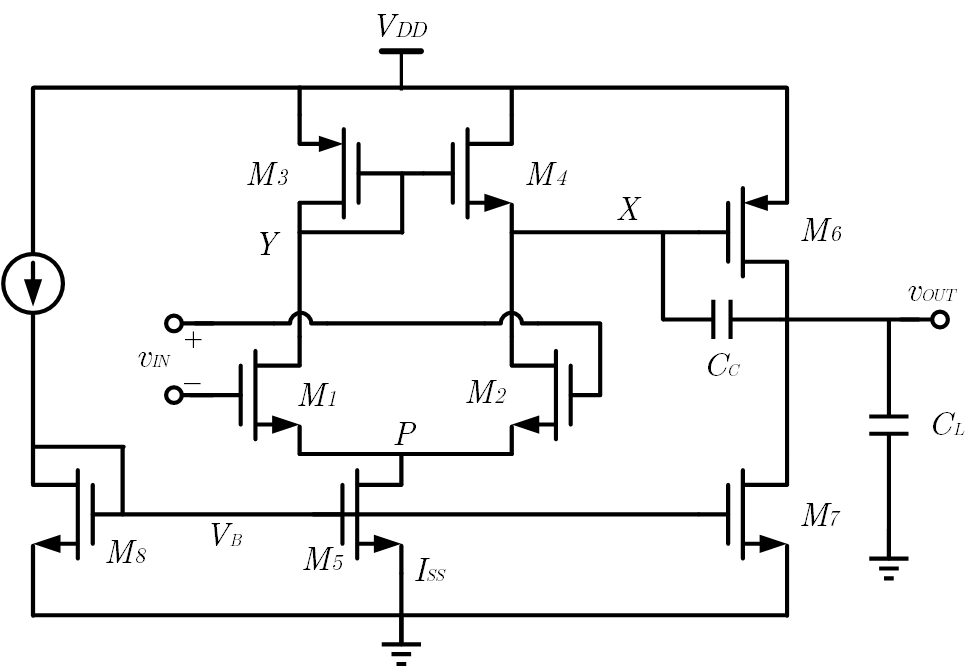

本篇的目的部分在于测试图片、字体、mathjax 等的配置情况。所以内容上可能没有什么条理，只是临时起意选取的，因为刚考完模集，所以随便选了其中一部分内容来用罢了
___

两级运放一般的结构是差分放大器与共源级的级联，前者提供一定的增益并消除共模噪声，后者在进一步提供一定增益的同时提供足够的输出电压摆幅；在集成技术中芯片内部的运放往往不需要驱动外部元件，所以可以不设输出级

这里是一个典型的单端输出两级运放，它由两部分组成：

1. OTA 形式的差分放大器，即 M1-M5 ，其中 M1 和 M2 是输入管对，M3 和 M4 是电流镜负载，M5 是尾电流源
2. 以电流源 M7 为负载的共源级 M6

$C_L$ 是负载电容（也包含了自带的 $C_{db6},C_{db7}$ ），$C_C$ 是补偿电容（也包含了自带的 $C_{gd6}$ ）

它的性质在部分教科书中被当作经典范式来使用，如 P.E.Allen 的 *CMOS Analog Circuit Design* 中的运放有关章节

1. **共模输入范围**：ICMR 与五管 OTA 保持一致，即向下要保证 M5 工作在饱和区以及 M1 勉强开通，向上要保证 M1 恰好在三极管区的边缘
   $$
   V_P + V_{TN} + \sqrt{\frac{2(I_{SS}/2)}{K_N(W/L)_1}}\leq V_{IC} \leq V_{TN}+V_{DD}-\sqrt{\frac{2(I_{SS}/2)}{K_P(W/L)_3}}-|V_{TP}|
   $$

2. **低频电压增益**：MOS 的输入电阻为无穷大，所以电压增益就是两级的电压增益之积
   $$
   A_v = g_{m1}(r_{ds4}\ ||\ r_{ds2}) \cdot g_{m6}(r_{ds6}\ ||\ r_{ds7})
   $$

3. **右半平面零点**：右半平面零点产生的原因是跨接电阻将 MOS 短接，只有 $C_C$ 满足这一条件，共源级给出的右半平面零点为
   $$
   \mathrm{RHPZ} = \frac{g_{m6}}{C_C}
   $$

4. **主极点与带宽**：由于 Miller 效应，$C_C$ 被折算回 X 点时成为原来的 $1+g_{m6}(r_{ds6}\ ||\ r_{ds7})$ 倍，而 X 到地的电阻 $r_{ds4}\ ||\ r_{ds2}$ 也是大电阻，故而 X 贡献出主极点，同时可以得出增益带宽积（对于有主极点的系统，也就是其辐值穿越频率）
   $$
   \mathrm{BW} = \omega_{p1} =\frac{1}{g_{m6}(r_{ds6}\ ||\ r_{ds7})(r_{ds4}\ ||\ r_{ds2})C_C} \quad,\quad \mathrm{GX} = \mathrm{GBW} = A_v \omega_{p1} = \frac{g_{m1}}{C_C}
   $$

5. **次极点与相位裕度**：由于镜像结点 Y 处电阻太小，所以输出结点 OUT 贡献出次极点，这里当频率接近次极点时 $j\omega C_C$ 相当大，将 M6 近似连接为 MOS 二极管，从 $C_L$ 两端看进去的电阻几乎就为 $1/g_{m6}$ ，所以可以得到次极点与相位裕度为
   $$
   \omega_{p2} = \frac{g_{m6}}{C_L} \quad,\quad \mathrm{PM} = 180^{\circ}- \arctan \left( \frac{\mathrm{GBW}}{\omega_{p1}} \right) - \arctan \left( \frac{\mathrm{GBW}}{\omega_{p2}} \right) - \arctan \left( \frac{\mathrm{GBW}}{\mathrm{RHPZ}} \right)
   $$

6. **转换速率**：由于是 $C_C$ 直接与差分放大器的输出相连，所以当阶跃输入过大时，所有 $I_{SS}$ 为 $C_C$ 充电，转换速率为
   $$
   \mathrm{SR} = \frac{I_{SS}}{C_C}
   $$

这种 OTA 差分对是单端输出的，它的好处在于只要参数合适，一旦上电就能正常工作。因为 M3 的接法是二极管式的，而且是低阻的，故而一旦给定 $I_{SS}$ 就可以直接得出其输出端的共模电压，因而不需要共模反馈（CMFB）；而采用 PMOS 电流源做负载的双端输出差分对则不同，由于电流源是高阻的，就算 $I_{SS}/2$ 和 $I_{D3},I_{D4}$ 之间有小的失调，也可能导致大的电压浮动，从而使得共模静态工作点难以确定，就需要共模反馈来改善

但是这种 OTA 差分对接法的坏处更为突出，主要是共模与差模没有明确的界限，即使差分对两侧晶体管参数完全匹配，仍然会产生共模到差模的增益，特别在高频情况下更为明显
