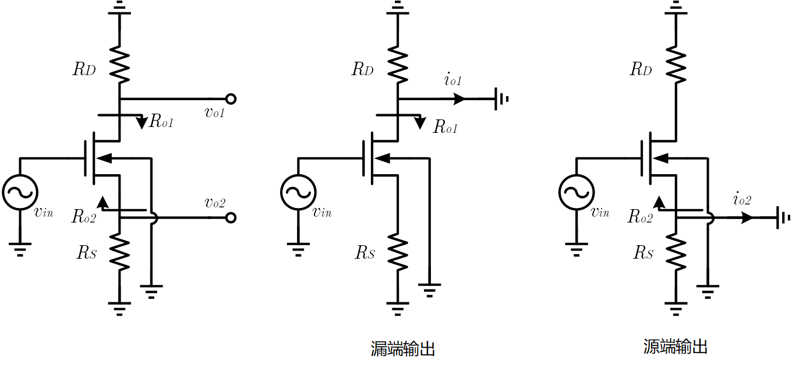
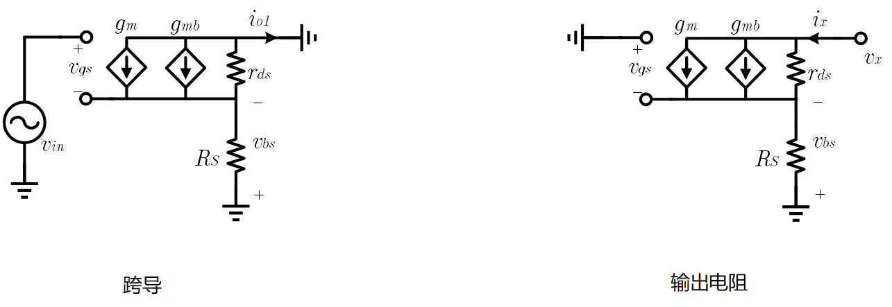
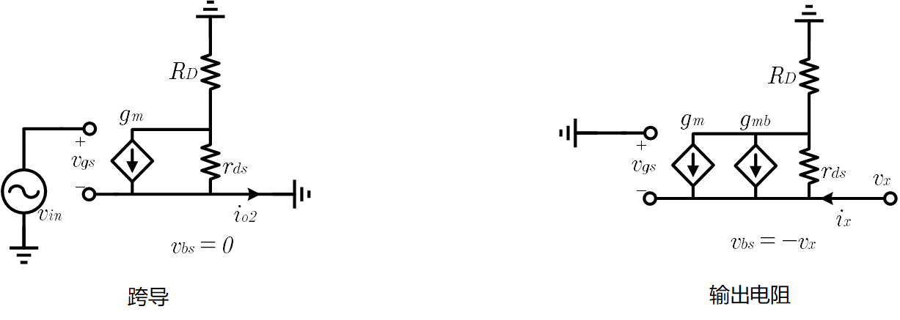
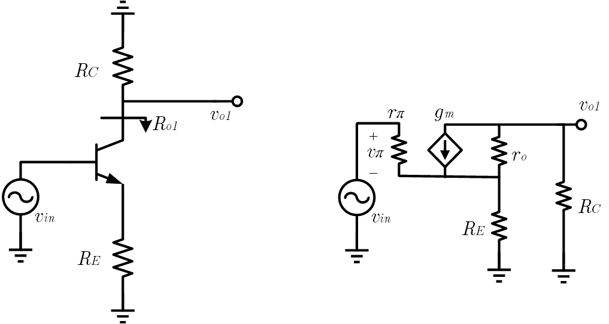
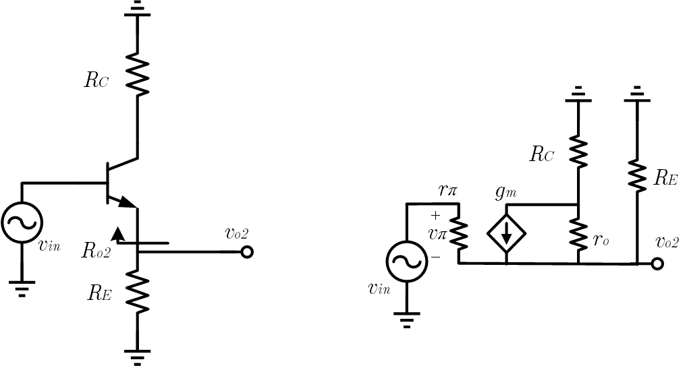

这里所说的 MOS 端口电阻是在**低频情况下**从漏端或者源端看进去的小信号电阻，即下图中的 $R_{o1},R_{o2}$​ ；因为低频下一般认为从栅极看进去的电阻就是无穷大，所以没必要特意计算

同时，也可以算出漏端输出和源端输出两种情况下的小信号跨导，即 $i_{o1},i_{o2}$ 和 $v_{in}$ 的关系，从而可以直接利用 Norton 定理得出小信号电压增益。而通过将图中的 $R_D,R_S$​ 置零恰可以分别得到共源级和源极跟随器

而且这些结果表现出相当统一的形式，可以直接记住拿来用。尽管分析是对 NMOS 进行的，但是结论对 PMOS 也是适用的，因为二者结构是对称的

## MOS 漏端输出

对于漏端输出的情况，计算小信号跨导和小信号输出电阻的小信号电路分别如下图

### 跨导增益

对计算跨导的小信号电路列写 KCL, KVL 得到
$$
\begin{cases}
v_{in} = v_{gs}-v_{bs} \\
i_{o1} = -g_{m}v_{gs} - g_{mb} v_{bs} - g_{ds}v_{bs} \\
v_{bs} = i_{o1} R_S
\end{cases}
$$
**式中的 $g_{ds}=1/r_{ds}$** ，将第三式代入第一式，得到 $v_{gs} = v_{in} + i_{o1}R_S$ ，再将该式和第三式代入第二式就有
$$
i_{o1} = -g_mv_{in} - i_{o1}g_mR_S - i_{o1}g_{mb}R_S - i_{o1}g_{ds}R_S
$$
整理可以得到
$$
G_1 = \frac{i_{o1}}{v_{in}} = \frac{-g_m}{1+(g_{m}+g_{mb}+g_{ds})R_S}
$$

### 输出电阻

对计算输出电阻的小信号电路列写 KCL, KVL 得到
$$
\begin{cases}
v_{gs} = v_{bs} \\
i_{x} = g_{m}v_{gs} + g_{mb} v_{bs} + g_{ds}(v_x + v_{bs}) \\
v_{bs} = -i_{x} R_S
\end{cases}
$$
将第三式代入第一式，得到 $v_{gs} = -i_{x}R_S$ ，将该式和第三式代入第二式就有
$$
i_x = -i_xg_mR_S - i_{x}g_{mb}R_S - g_{ds}(v_x-i_xR_S)
$$
整理可以得到
$$
R_{o1} = \frac{v_x}{i_x} = \frac{1+(g_m+g_{mb}+g_{ds})R_S}{g_{ds}} = [1+(g_m+g_{mb}+g_{ds})R_S]r_{ds}
$$
这个倍乘系数（或者视为一个负反馈的环路增益）和上面跨导增益处是一样的，可以先记为 $H_S = (g_m+g_{mb}+g_{ds})R_S$ ，下面的源端输出也会给出类似的系数

## MOS 源端输出

对于源端输出的情况，计算小信号跨导和小信号输出电阻的小信号电路则分别如下图

### 跨导增益

同样地，直接对计算跨导的小信号电路列写 KCL, KVL 得到
$$
\begin{cases}
v_{in} = v_{gs} \\
i_{o2} = g_{m}v_{gs} + g_{ds}v_d \\
v_{d} = -i_{o2} R_D
\end{cases}
$$
这里 $v_d$ 指漏极的电压，将第三式和第一式代入第二式有
$$
i_{o2} = g_mv_{in} - i_{o2}g_{ds}R_D
$$
整理可以得到
$$
G_2 = \frac{i_{o2}}{v_{in}} = \frac{g_m}{1+g_{ds}R_D}
$$

### 输出电阻

还是直接对计算输出电阻的小信号电路列写 KCL, KVL 得到
$$
\begin{cases}
v_{gs} = v_{bs} = -v_x \\
i_{x} = -g_{m}v_{gs} - g_{mb} v_{bs} + g_{ds}(v_x -v_d) \\
v_{d} = i_{x} R_D
\end{cases}
$$
将第一式和第三式代入第二式就有
$$
i_x = g_{m}v_x + g_{mb}v_x + g_{ds}(v_x - i_xR_D)
$$
整理可以得到
$$
R_{o2} = \frac{v_x}{i_x} = \frac{1+g_{ds}R_D}{g_m + g_{mb}+g_{ds}} = [1+g_{ds}R_D](1/g_m\ ||\ 1/g_{mb}\ ||\ r_{ds})
$$
这个倍乘系数记为 $H_D = g_{ds}R_D$ 

## MOS 情况的总结

由上面的内容，可以分别计算从漏端和源端输出时的电压增益，这只需要将跨导增益和输出电阻相乘即可，但是此时的输出电阻不止有 $R_{o1},R_{o2}$ ，也有 $R_D,R_S$ ，即
$$
A_{v1} = G_1 (R_{o1}\ ||\ R_D) = \frac{-g_m}{1+H_S} \cdot \frac{(1+H_S)r_{ds}R_D}{(1+H_S)r_{ds} + R_D} = \frac{-g_mR_D}{1+H_S + g_{ds}R_D}
$$
以及
$$
A_{v2} = G_2 (R_{o2}\ ||\ R_S) = \frac{g_m}{1+H_D} \cdot \frac{[(1+H_D)/(g_{m} + g_{mb}+ g_{ds})]R_S}{(1+H_D)/(g_{m} + g_{mb}+ g_{ds}) + R_S} = \frac{g_mR_D}{1+H_D + (g_{m} + g_{mb}+ g_{ds})R_S}
$$
再注意到 $H_S = (g_m+g_{mb}+g_{ds})R_S$ 和  $H_D = g_{ds}R_D$ 就可以列出

> - 漏端输出时：跨导增益 $\displaystyle{G_1 = \frac{-g_m}{1+H_S}}$ ；输出电阻 $\displaystyle{R_{o1} = (1+H_S)r_{ds}}$ ；电压增益 $\displaystyle{A_{v1} = \frac{-g_mR_D}{1+H_S+H_D}}$ 
> - 源端输出时：跨导增益 $\displaystyle{G_2 = \frac{g_m}{1+H_D}}$ ；输出电阻 $\displaystyle{R_{o2} = (1+H_D)(1/g_m\ ||\ 1/g_{mb}\ ||\ r_{ds})}$ ；电压增益 $\displaystyle{A_{v2} = \frac{g_mR_S}{1+H_S+H_D}}$ 

而由于很多情况下可以近似认为 $g_m \gg g_{ds}$​ ，所以也可以利用上述关系快速判断端口阻抗是比较大还是比较小

### 应用到单级放大器上

1. 共源级

   令 $R_S=0$ 即可，此时 $H_S=0$ 

   所以 $G=-g_m$ ；$R_o = r_{ds}$ ，是个大电阻；$A_{v1}=-g_mR_D/(1+g_{ds}R_D)$ ，由于 $g_{ds}$ 相对较小，所以电压增益相对比较可观

2. 共漏级

   令 $R_D=0$ 即可，此时 $H_D=0$​ 

   所以 $G=g_m$ ；$R_o = 1/g_m\ ||\ g_{mb}\ ||\ r_{ds}$ ，是个小电阻；$A_{v1}=g_mR_S/[1+(g_m+g_{mb}+g_{ds})R_S]$ ，由于 $g_{m}$ 相对较大，所以电压增益较接近但略小于 1 

3. 共栅级

   共栅级稍微特殊一点，因为输入不在栅极。但是注意到输入在源端，而栅极接交流地，所以 $v_{gs}=v_{bs}=-v_{in}$ 

   于是跨导可以直接写出为 $G=g_m+g_{mb}+g_{ds}$ ；输入电阻是从源极看进去的电阻 $R_i = (1+H_D)(1/g_m\ ||\ 1/g_{mb}\ ||\ r_{ds})$ ，是个小电阻；输出电阻则为从漏极看进去的电阻 $R_o = r_{ds}$ ，是个大电阻；电压增益为 $A_v = G(R_o\ ||\ R_D)$ 

## BJT 的端口电阻

BJT 的混合 pi 模型和 MOS 的模型比较相似，只是多了一个 $r_{\pi}$ ，为基极电流提供了一个通路，所以可能会有相似的结论

### 从集电极输出

从集电极输出的情况如下图所示，右侧是小信号电路，其中 $g_m = \beta/r_{\pi}$ 

要计算 $R_{o1}$ ，将 $v_{in}$ 置零，然后从 $R_C$ 的左边看进去。之后只要将 $r_{\pi}\ ||\ R_E$ 视为 $R_S$ ，其实就和 MOS 一样了，所以就有
$$
R_{o1} = [1+(g_m+1/r_o)(r_{\pi}\ ||\ R_E)]r_o
$$

### 从射极输出

从射极输出的情况如下图所示，右侧是小信号电路

要计算 $R_{o2}$ ，将 $v_{in}$ 置零，然后从 $R_E$ 的左边看进去。如果 $r_{\pi}$ 是开路，那么就和 MOS 一样了，而 $r_{\pi}$ 又是并联在输出端口和交流地之间的，也就是说 $R_{o2}$ 相当于 MOS 的情况并上一个 $r_{\pi}$ ，即
$$
R_{o1} = [1+R_E/r_o](1/g_{m}\ ||\ r_o)\ ||\ r_{\pi}
$$

### 基极端口电阻

不同于 MOS ，即使在低频情况下，BJT 从基极看进去时也并不能视为开路。对于上面两种情况来说，从基极看进去的电阻都是一样的，如果先忽略 $r_o$ ，那么输入的电流就是 $i_b$ ，它流过 $r_{\pi}$ 之后，被放大了 $\beta+1$ 倍又流过 $R_E$ 到交流地，所以
$$
R_i = \frac{v_{in}}{i_b} = r_{\pi} + (\beta+1)R_E
$$
